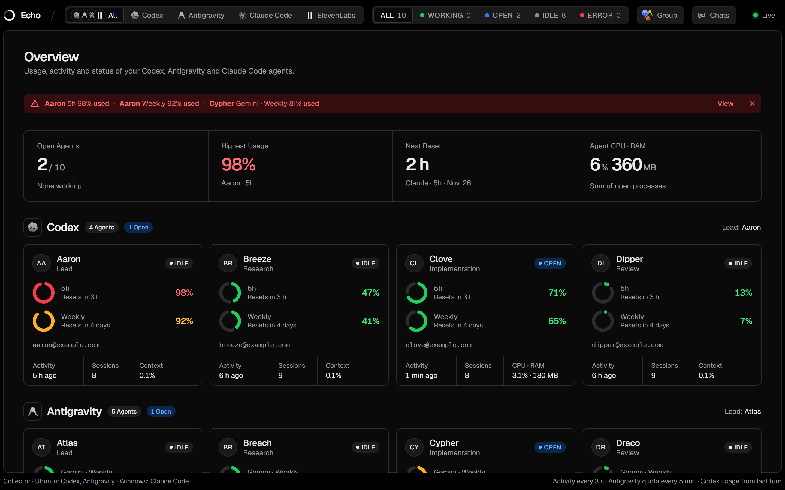
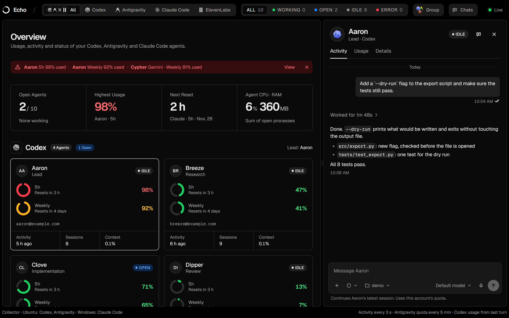
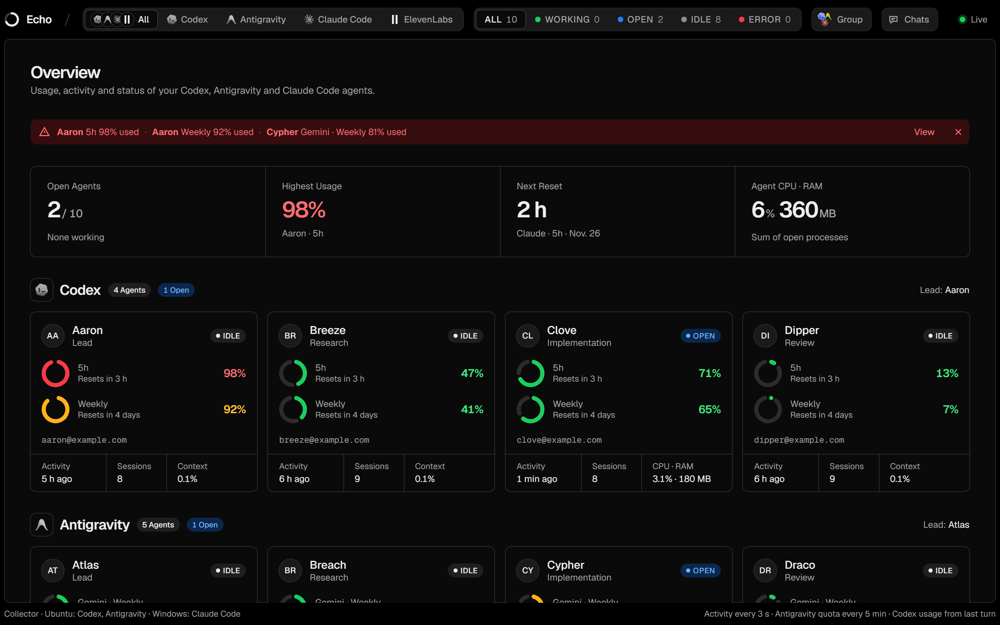
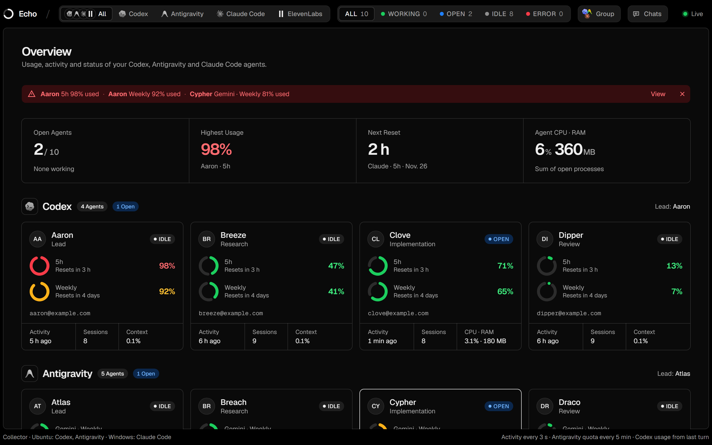
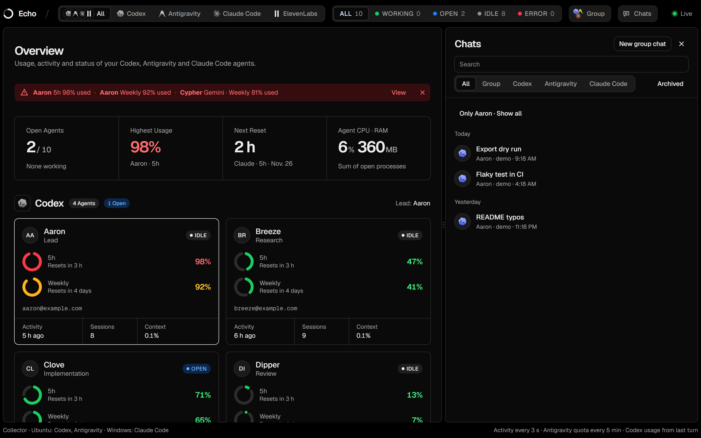
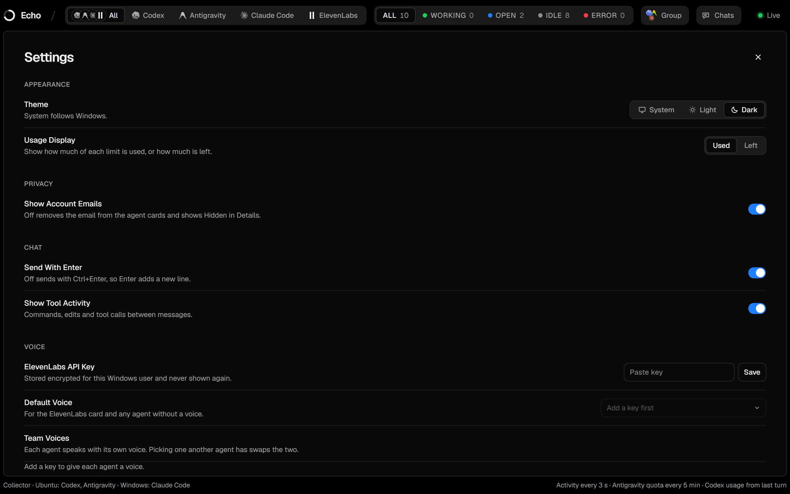

<div align="center">

# Echo

**Mission control for people who have more AI coding subscriptions than houseplants.**

A small Windows app that watches your Codex, Antigravity and Claude Code agents and tells you:
- who is working;
- how much of each account's quota is gone;
- when it comes back;
- what each agent has been up to while you got coffee.



</div>

---

## The problem, plated

At some point you had one coding agent. It was fine. Then you had a second one "for research".

Now you run **ten** of them over three CLIs:
- four Codex accounts;
- five Antigravity accounts;
- one Claude Code;
- and a tab with a spreadsheet that's meant to track their usage limits, last updated in March.

Echo is that spreadsheet, made gourmet. We took the humble act of *checking how much quota you have left* and plated it with a reduction of WebView2, a light Geist foam and a drizzle of ring charts. It reads the files each CLI already writes on your machine and serves the lot in one dark dashboard.

> **What Echo is not:** a limit dodger. It does not rotate accounts, move work to whoever still has quota, or touch any provider's rate limits. When an agent hits its limit, Echo says so (in red, with feeling) and **won't send it anything** until it resets. What you do about that stays your call, under your providers' terms.

## What's on the menu

### Overview: every agent, one glance
Each card shows the agent's role, its status (working, open, idle or error) and one ring per usage limit. The 5-hour window, the weekly window and the per-model quota each get a ring and a reset time. A banner shouts when anything passes 80%.

### An agent's own chat
Click a card to open that agent's chat. Echo reads the session the CLI recorded, so you see the same conversation you'd see in its terminal, rendered like a chat app:
- **Worked for 1m 48s**, collapsed: commands, edits and tool calls fold away, Codex-style, and only the final answer stays out.
- Each command opens into a **Shell** block with its output.
- Ticks show where a message is: 🕐 not sent yet, ✓ sent, ✓✓ received, and **white** ✓✓ once the agent has answered.
- You can reply right there. Pick the model, the effort level, the folder and the access mode (read only through full access). Echo hands your message to that CLI with your own login.



### Group chat
Put the whole team in one room:
- `@mention` who should act; everyone else just reads along.
- Agents can hand work to each other with `@Name: do the thing`. In Full access those hand-offs go straight out. Otherwise each one waits on a card for your **Send** or **Skip**.
- A turn cap and a ping-pong guard stop two agents from passing the same task back and forth all afternoon.



### Usage, in detail
Each agent's **Usage** tab lists every limit the CLI reports, what share of it is used, and when it resets. These numbers come from files the CLIs already write: Codex's session logs, Claude Code's usage endpoint, and Antigravity's `agy /usage`, which spends zero tokens.



### Chats
Browse every past session of every agent. You can rename one, archive it, or delete it.
- Codex sessions are deleted with `codex delete`.
- Claude Code sessions are deleted by removing the session's own files.
- Antigravity's database is never written to: Echo only hides those rows.
- A session that is in use right now can't be deleted.



### Voices (optional)
Add an ElevenLabs key and every agent gets a voice of its own. Replies can be read aloud, and when a group task finishes, a short spoken recap plays: each agent says what it did, in its own voice. Ten agents, ten voices.



## How it works

```
Echo.exe (WinForms + WebView2)
  ├─ ui/index.html        the whole interface, one file
  ├─ snapshot.py          read-only collector: prints one JSON snapshot every 3 s
  ├─ send.py              hands your message to codex / agy / claude
  └─ convs.py             lists, opens and deletes past sessions
```

- The Python scripts run where the agents live: in WSL, on Windows, or in both. Echo works out which and labels each place in the footer.
- **Echo only reads.** `snapshot.py` never writes to an agent's home, and opens SQLite databases with `mode=ro`.
- Nothing is sent anywhere except to the CLIs you already use, and to ElevenLabs if you add a key.
- Your ElevenLabs key is encrypted with Windows DPAPI for your Windows user, and the UI never shows it again.

## Setup

**You need:**
- Windows 10 or 11, with the WebView2 runtime (already on most machines);
- the .NET Framework 4.8 compiler, which ships with Windows;
- Python 3.10 or newer, on Windows or in WSL;
- any of these CLIs, signed in: `codex`, `agy` (Antigravity) and `claude` (Claude Code).

**Build and install** to `%LOCALAPPDATA%\Programs\Echo`:

```powershell
./build.ps1
```

**Point it at your agents.** Echo finds the default homes on its own (`~/.codex`, `~/.gemini`, and Claude Code under your Windows user). To run several accounts of one CLI, give each its own home and list them in `agents.json` next to `snapshot.py`:

```json
{
  "agents": [
    { "team": "Codex", "name": "Aaron", "role": "Lead", "home": "~/.codex" },
    { "team": "Codex", "name": "Breeze", "role": "Research", "home": "~/work/breeze/.codex" },
    { "team": "Antigravity", "name": "Atlas", "role": "Lead", "home": "~/.gemini" }
  ]
}
```

To choose how Echo runs the scripts (`python`, `py -3` or `wsl.exe -- python3`) and where they are, open **Settings → Installation**.

## Checks

```powershell
node tests/room_check.js ui/index.html   # mentions, hand-offs, prompt sizes, voices
python3 tests/convs_check.py             # session listing and delete guards
python3 test_snapshot.py                 # Claude usage parser, offline
```

## Screenshots

The images above come from a demo build that uses invented data. No real chats or accounts were harmed, and `aaron@example.com` is not a real person. To take them again:

```powershell
./docs/demo/shoot.ps1
```

## Credits

- Geist and Geist Mono fonts © Vercel (SIL OFL 1.1).
- KaTeX (MIT).
- Codex and Antigravity icons from `@lobehub/icons-static-svg` (MIT).
- Codex, Antigravity, Claude Code and ElevenLabs are trademarks of their owners. Echo isn't affiliated with any of them: it's a fan with a dashboard.

See [ui/NOTICE.txt](ui/NOTICE.txt) for the full notices.
